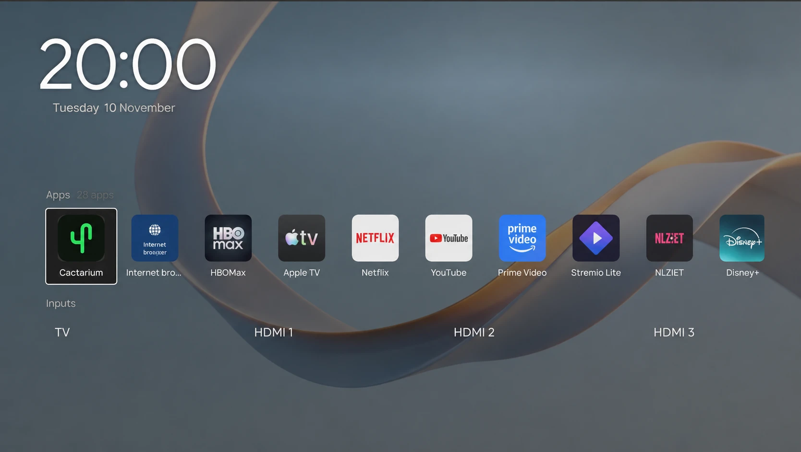
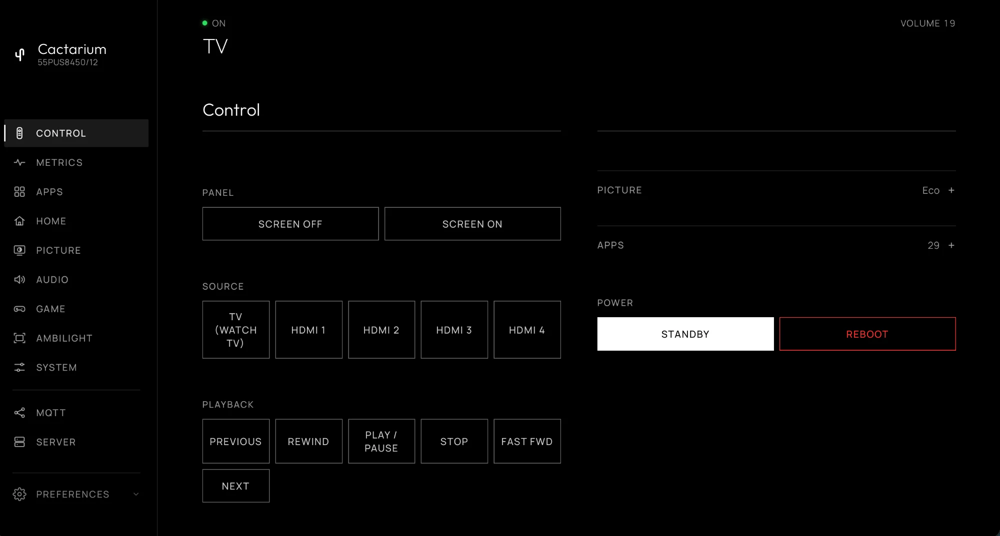
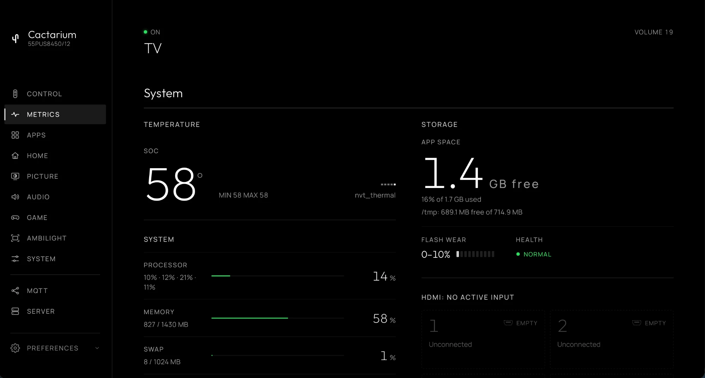
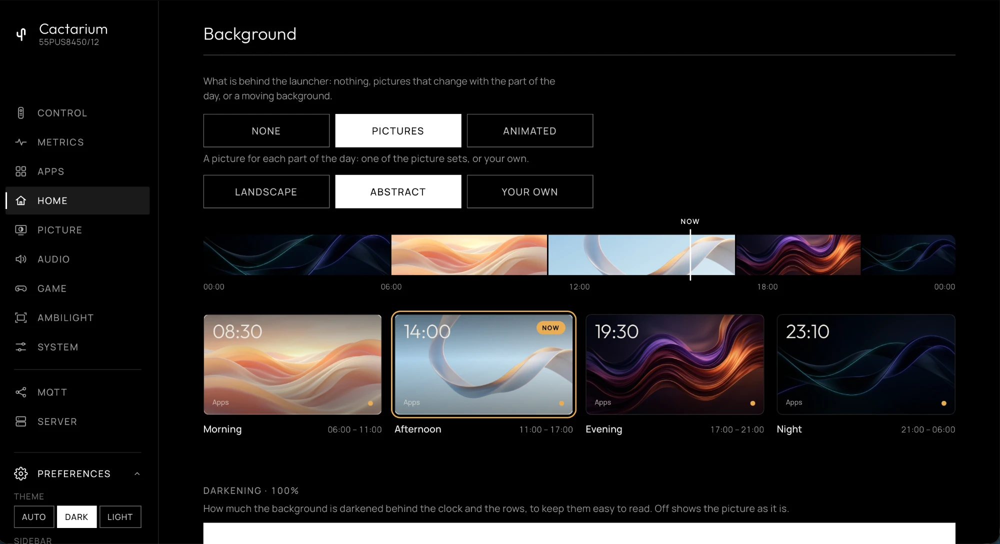

# Cactarium

**Your TV, your home screen.** A dashboard, a launcher and a Home Assistant bridge for Philips TitanOS TVs you can already reach over SSH.

> [!WARNING]
>
> ## Cactarium does not root your TV
>
> This project contains nothing for rooting or jailbreaking a TV: no exploit, no payload,
> no way in. It starts from a TV you can already reach over SSH. Getting there is entirely
> the work of **[abbguslof](https://github.com/abbguslof)**, published as
> **[philips-titanos-tools](https://github.com/abbguslof/philips-titanos-tools)**, together
> with **[this jailbreak guide](https://gulo.se/thoughts/philips-titan-os-jailbreak-guide/)**.
> Follow them to get SSH on your TV, and read their safety and restore notes first.
>
> abbguslof did the hard part: reverse-engineering TitanOS on the Novatek NT72690
> platform, mapping its boot chain, finding and verifying the USB root path and the persistent
> root that survives a reboot, documenting JointSpace, Ambilight and the TV's internals, and
> publishing all of it openly with a way back to stock. Cactarium's knowledge of how these
> TVs work, from the JointSpace calls to where it can safely live on the TV, builds on that
> research.
>
> Without abbguslof's work there would be no way onto these TVs and no Cactarium. All credit
> for opening up Philips TitanOS TVs belongs to abbguslof. If this project is useful to you, star
> [philips-titanos-tools](https://github.com/abbguslof/philips-titanos-tools) and say thank you.

> [!IMPORTANT]
>
> ## Every idea here comes from Glasshouse
>
> Cactarium is a port of **[Glasshouse](https://github.com/rorygallagher2024/glasshouse)**,
> created by **[Rory Gallagher](https://github.com/rorygallagher2024)**, from LG webOS
> to Philips TitanOS. The idea of a local server on the TV itself, the dashboard and its
> tabs, the launcher and the Glasshouse Home look, the TV app, the Home Assistant bridge,
> the project layout, the documentation and the way of working all come from Glasshouse.
> What Cactarium adds is only the Philips plumbing underneath.
>
> This project would not exist without Rory's work. If Cactarium is useful to you, go and
> star [Glasshouse](https://github.com/rorygallagher2024/glasshouse), read its docs, and
> support its author. The Glasshouse code reused here is MIT licensed and credited in
> [NOTICE](NOTICE).

> [!CAUTION]
>
> ## Not yet safe to use
>
> Cactarium has not had a security audit. It runs as `root` on the TV, opens a
> web server on your home network, changes the TV's boot script and UI page, and
> calls the TV's own internal functions. Treat it as experimental: it is not yet
> safe to use, and you run it entirely at your own risk.
>
> It comes with **absolutely no warranty** of any kind. The authors accept no
> responsibility for damage, a TV that no longer starts, lost data, a voided
> warranty or anything else that follows from using it. See [LICENSE](LICENSE).

> [!NOTE]
>
> ## You bought the TV.
>
> **It's your TV and you should control it.**
>
> Designed for those who would rather their network-connected home appliances
> were not a platform for advertising and vendor-controlled experiences, this
> project brings control, visibility and automation back to the device.
>
> Cactarium itself is local, transparent, and requires no cloud service of its
> own. No data collection, no ads, no dark patterns.

**Cactarium** is a small server that runs directly on a Philips TitanOS TV. It serves a live browser dashboard to any phone or computer on the home network, controls the TV through its own local JointSpace API, reads hardware telemetry from `/proc` and `/sys`, bridges the TV to Home Assistant over MQTT, and can replace the TitanOS home screen with a launcher of its own.

It is one static Go binary with no runtime dependencies on the TV. It is modelled on [Glasshouse](https://github.com/rorygallagher2024/glasshouse), the equivalent project for LG webOS TVs, and the launcher and dashboard themes are derived from it (see [NOTICE](NOTICE)).

### Compatibility at a glance

* **TV**: Philips 55PUS8450/12 (chassis TPN256E, Novatek NT72690), firmware TPN256E_V056.010.032.001. This is the only TV it has been tried on. Other Philips TitanOS TVs may work, but nothing is confirmed
* **Access**: SSH to the TV must already work (Dropbear on port 2222 with key authentication, the setup the `philips-titanos-tools` repository describes). Cactarium does not root the TV, does not provide a way in, and does not work around SELinux
* **Computer**: Go 1.22 or later, `make`, `ssh` and `shasum` or `sha256sum`, to build and install
* **Internet on the TV**: not needed for the dashboard, remote or Home Assistant. The launcher's optional app row, app icons and weather badge reach out to the public TitanOS catalog and to Open-Meteo, as described in [what it changes on the TV](docs/TV-CHANGES.md#network)

**[Read the documentation](docs/index.md)** for the features, installation, Home Assistant and security.

---

## Quick start

1. Make sure you can `ssh -p 2222 root@<tv-ip>` with a key.
2. Clone this repository on a computer on the same network as the TV.
3. Run `server/deploy.sh <tv-ip>` from the repository root.
4. Open `http://<tv-ip>:8090/` in a browser and pair with the TV in the Server tab.

That's it. The dashboard is ready to use. Starting it again after a power cut is a separate, optional step (`--enable-boot`).

The [installation guide](docs/install.md) has the details and troubleshooting.

---

## What it's for

This project is intended to give a Philips TitanOS TV a useful local control surface and a home screen the owner chooses, instead of requiring them to work around the TV's built-in menus and cloud launcher.

1. **[A phone and computer dashboard](docs/dashboard/index.md).** Tabs laid out as in Glasshouse's dashboard: Control (remote, inputs, volume, picture styles, power and reboot), Metrics, Apps, Home, Picture, Audio, Game, Ambilight with a live preview, System, MQTT and Server, in the browser with no app to install.

2. **[Controlling the TV without the cloud](docs/dashboard/control.md).** Keys, volume, mute, power and Ambilight go through the TV's local JointSpace API, which Cactarium pairs with once.

3. **[A launcher in place of the TitanOS home screen](docs/launcher.md).** Pressing Home, and turning the TV on, shows Cactarium's launcher: a clock, an optional weather badge, a row of apps that mirrors your TitanOS apps, and the TV's inputs. A double press of Home reaches the stock TitanOS home.

4. **[Keeping the TitanOS cloud launcher out of the way](docs/launcher.md#blocking-the-titanos-cloud-launcher).** An optional, exact-name firewall block on `app.titanos.tv` so the TV does not load its cloud launcher. Sign-in and the TitanOS API are left alone.

5. **[Integrating the TV with a smart home](docs/HOME-ASSISTANT.md).** The MQTT bridge exposes the TV as one device with power, volume, mute, Ambilight, sensors and buttons through MQTT Discovery, and accepts commands from Home Assistant or any other MQTT client.

6. **[Seeing what the TV is actually doing](docs/dashboard/metrics.md).** CPU load, memory, temperatures, uptime, network rates, Wi-Fi signal, storage and the TV's own system information.

---

## Screenshots

**The dashboard's Control tab**

**Metrics**

**Home: the launcher's background**

---

## Documentation

* [Installing](docs/install.md)
* [The dashboard](docs/dashboard/index.md), tab by tab
* [The launcher](docs/launcher.md)
* [Home Assistant](docs/HOME-ASSISTANT.md)
* [Updating and uninstalling](docs/managing.md)
* [Security](docs/SECURITY.md)
* [What it changes on the TV](docs/TV-CHANGES.md)
* [Internals](docs/IMPLEMENTATION.md)
* [Contributing](docs/CONTRIBUTING.md) and [testing](docs/development/testing.md)

The pages are built from [docs/](docs/), so they can also be read there.

---

## Security

The dashboard has **no authentication by default**, so anyone on the same network can press the TV's buttons. **Never expose port 8090 directly to the internet (do not port-forward).** [Security](docs/SECURITY.md) covers the access token, the world-writable config file on this firmware, the unauthenticated launcher endpoints, and MQTT.

---

## Contributing

Contributions are welcome. [Contributing](docs/CONTRIBUTING.md) covers the working conventions, how to run the checks (`sh scripts/check-all.sh`) and how to test on a real TV. Raw firmware files and device dumps are never committed.

---

## Disclaimer

**Use this software at your own risk.**

* **Root access and hardware.** This runs a custom server with `root` privileges on an embedded TV OS and edits the TV's boot script and, optionally, a copy of its UI page. It is designed to leave the read-only rootfs untouched and has an [escape hatch](docs/managing.md#if-something-goes-wrong) for each change, but the author accepts **no responsibility** for damage, bootloops, bricked devices, voided warranties or data loss.
* **The home screen replacement.** The launcher hooks the TV's own UI. It has been tried on one TV and one firmware. A different firmware may behave differently.
* **Power and control commands.** Power off, the dashboard's restart (which reboots the TV) and Ambilight changes are real commands. Understand what each does before using it.
* **Trademarks.** An independent, unofficial community project, not affiliated with or endorsed by Philips, TP Vision or TitanOS. Philips and TitanOS are trademarks of their owners.
* **Fonts.** Bundles [Outfit](https://github.com/Outfitio/Outfit-Fonts) and [Manrope](https://github.com/sharanda/manrope) under the [SIL Open Font License 1.1](https://openfontlicense.org/); licence texts ship in `server/assets/fonts/`.

## License

Cactarium is released under the [MIT licence](LICENSE). The parts derived from Glasshouse stay under Glasshouse's own MIT licence and keep its copyright notice; see [NOTICE](NOTICE).
