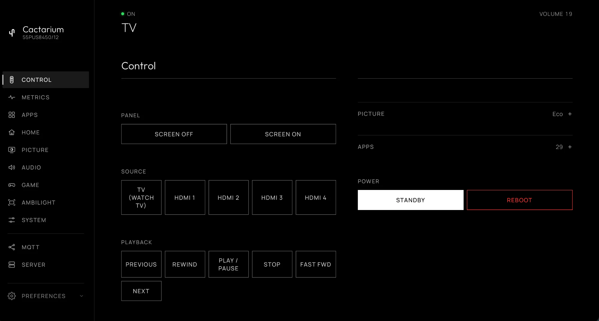

# Control

The **Control** tab, `/?tab=control`, controls the TV through its local JointSpace API, with no cloud service. It needs the TV to be [paired](server.md#pairing).

* **Panel.** **Screen off** blanks the panel while the TV keeps running; **Screen on** brings it back. Through the PHI bridge, so not available while an app is open.
* **Source.** The TV and each HDMI input, named after the device behind it where the TV knows one, as on the launcher's Inputs row. JointSpace refuses the input list on TitanOS, so this goes through the TV's UI page and is not available while a web app is open.
* **Playback.** Previous, rewind, play/pause, stop, fast forward and next.
* **Volume.** A slider, `-` and `+`, and **Mute**. The slider range follows the TV's own maximum.
* **D-pad.** Up, down, left, right and OK, Back, Home, Options, Source and Info, the colour keys and channel up and down. Home opens the [launcher](../launcher.md) if it is installed. A **Number pad** folds open below it.
* **Picture.** The TV's picture styles as buttons, through the bridge. The [Picture tab](picture.md) has the settings.
* **Apps.** A button for each app on the launcher's row. See [Apps](apps.md).
* **Power.** Switches between On and Standby. **Reboot** restarts the TV's software after a confirmation (`POST /api/tv/reboot`); the TV is unavailable for about a minute.

## Keyboard

While the Control tab is open, a computer's keyboard works as the remote: the arrow keys, **Enter** for OK, **Backspace** or **Esc** for Back, **H** for Home, **M** for mute, **+** and **-** for volume. Keys typed into a field, or pressed with Ctrl, Alt or Cmd, are left to the page.

## Keys by name

Anything the API accepts is a JointSpace key name; the dashboard uses `Standby`, `Back`, `Home`, `Options`, `Info`, `Source`, `CursorUp/Down/Left/Right`, `Confirm`, `VolumeUp/Down`, `Mute`, `ChannelStepUp/Down`, `RedColour`, `GreenColour`, `YellowColour`, `BlueColour`, `Digit0` to `Digit9`, and the media keys. `scripts/key.sh` sends them from a terminal, and Home Assistant's `key/set` topic accepts them too.
