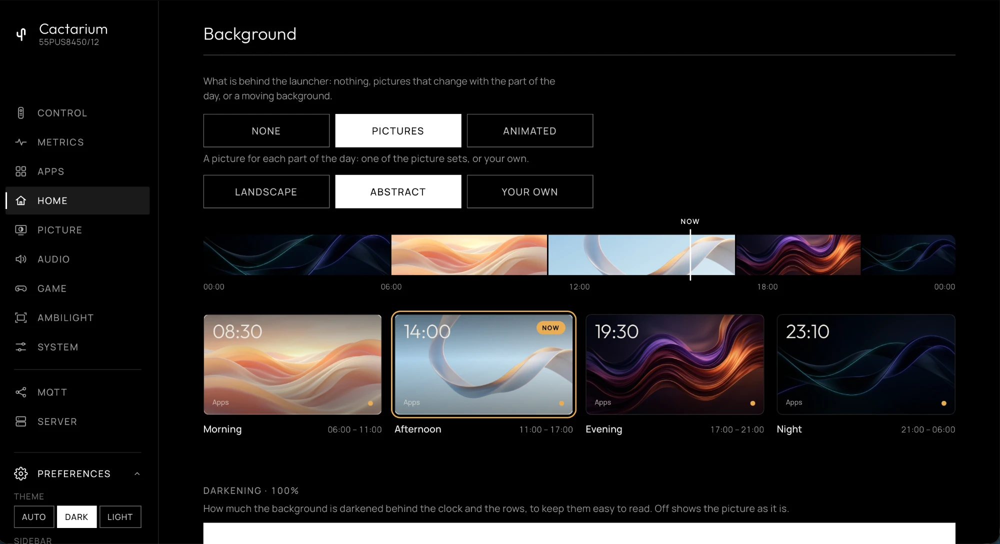

# Home

The **Home** tab, `/?tab=home`, sets what the Home button opens. See [the launcher](../launcher.md) for how it works.

* **Choose your launcher.** **TitanOS Home** or **Cactarium launcher**. Takes effect on the next Home press; press Home twice quickly for the stock TitanOS home.
* **Apps row.** The apps the launcher shows, in order (`launcher.apps`). Move an app up or down, remove it, or add one from the TitanOS catalog with the search box (`GET /api/titan/catalog`). **TV input** adds the tile for the TV's inputs. Left empty, the launcher uses the TV's own app list.
* **Block TitanOS home.** Stops the TV loading the TitanOS cloud launcher (`launcher.block_titanos`). See [blocking the TitanOS cloud launcher](../launcher.md#blocking-the-titanos-cloud-launcher).
* **Weather.** A latitude and longitude for the launcher's weather badge (Open-Meteo). Leave both empty to turn it off.
* **Background.** What is behind the launcher's clock and rows: [None, Pictures or Animated](#background), and its darkening.

Each change is saved at once to `config.json`.

## Background

The **Background** section chooses what is behind the launcher, and shows only the settings for that choice. It is Glasshouse Home's Background, ported (credited in the repository's `NOTICE`). It is saved as `launcher.background` (`kind` `none`, `pictures` or `animated`).

* **None**, the default: pure `#000` black.
* **Pictures**: a picture for each part of the day.
* **Animated**: light that moves slowly behind the rows.

### Pictures

A picture for each of four times of day: **Morning** (06:00 to 11:00), **Afternoon** (11:00 to 17:00), **Evening** (17:00 to 21:00) and **Night** (21:00 to 06:00). There are three sets to choose from:

* **Landscape**, a loch at four times of day, and **Abstract**, four flowing abstract pictures. A set is downloaded to the TV when it is chosen, about 820 KB, from [glasshouse-wallpapers](https://github.com/rorygallagher2024/glasshouse-wallpapers) (the `v2` tag, each picture checked against a pinned SHA-256). Only the chosen set is kept on the TV: choosing the other set, **Your own** or **None** removes it.
* **Your own**: pictures uploaded from the browser, one for each time of day. They are kept while a set or another background is chosen, and come back with **Your own**. Uploading a picture chooses **Your own**.

The dashboard shows the day as a strip from midnight to midnight, each time of day filled with its picture across its hours and a marker at the time now, and below it each time of day as a small launcher: its picture behind the clock and the Apps label. The time of day showing now is marked **Now**.

With **Your own** chosen:

* Choosing a time of day, on the strip or its preview, or dropping an image on it, sets its picture. JPEG, PNG and WebP images up to 25 MB are taken; the browser scales each to fit 1920 × 1080 as a JPEG before sending it, and the server keeps it under `var/home-wallpapers/own/` on the TV (at most 5 MB each).
* **Replace** and **Remove** under a time of day change or remove its picture alone; one without a picture is black.
* **Remove all** takes every picture away.

The launcher cross-fades from one picture to the next as the time of day changes.

### Animated

Seven moving backgrounds, each drawn in place of the pictures:

* **Light waves**: soft bands of light with a bright thread along their edges.
* **Particles**: soft lights rising and twinkling.
* **Aquarium**: a tank seen through its side, with light from the surface, fish at every depth, waving weed and rising bubbles.
* **Aurora**: curtains of light hanging from the top, their lower edges swaying.
* **Glow**: a few large, soft pools of colour drifting and blending where they meet.
* **Constellations**: points of light drifting slowly, joined by fine lines while they are near one another.
* **Ripples**: a still surface where now and then a drop falls and spreads in thin rings.

An animated background keeps the TV busy while the launcher is on screen. It draws 20 times a second (10 where a frame takes the TV longer than 28 ms), stops as soon as the launcher is hidden by an app, an input or Back, and is a still picture where the browser asks for reduced motion.

Its colours: **Time of day**, the default, follows the four times of day, and the aquarium dims in the evening and at night; five presets, **Night blue**, **Sunset**, **Emerald**, **Ember** and **Silver**; or **Your own**, a background and a light colour picked here (`own_colours`). In the aquarium they are the water and the light through it.

### Darkening

**Darkening** sets how much the background is darkened behind the clock and the rows, which keeps them easy to read on a bright picture. It is 100% by default; the slider goes down in steps of 5% to **Off**, which shows the picture as it is. Behind an animated background it is lighter, as these are dark already. With **None** chosen it is not shown.

