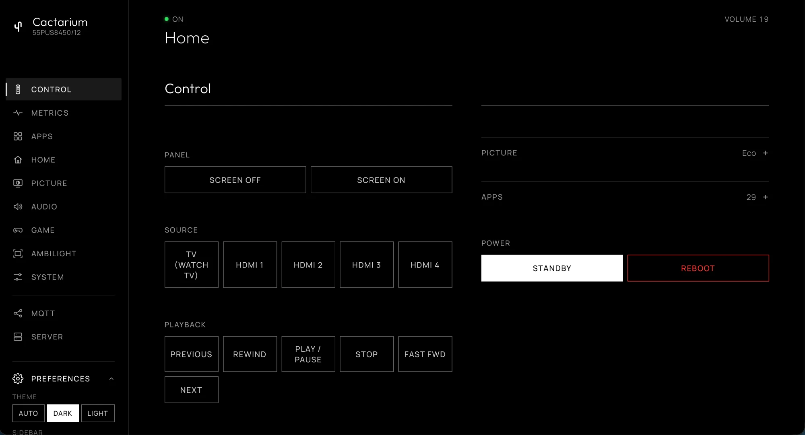

# The dashboard

Open `http://<tv-ip>:8090/` on any phone, tablet or computer on the home network. There is nothing to install. The tabs follow [Glasshouse](https://github.com/rorygallagher2024/glasshouse)'s dashboard, for the functions a Philips TitanOS TV has, and each has a deep link: `/?tab=control` or `/#control`, and so on.

The TV's model (from the TV's own `RpcModelInfoGet`, else the launcher's catalog model) is under the Cactarium logo. The top of every tab shows the TV's state (On, or Unreachable when the TV does not answer), what is on screen under it in large type (Home, an app, streaming channels, a tuner, or the name of an HDMI input; the TV's name while a web app has the TV's UI page frozen), and the volume opposite ("Volume 17" or "Muted"). The TV is shown as On whenever it answers, because it suspends to RAM in standby and stops answering altogether.

On a wide screen the tabs are listed down the left, under the TV's name. On a phone, or wherever Preferences is set to hide the sidebar, they open from the menu button at the top of the page.

-   **[Control](control.md)**

    ---

    The remote, inputs, volume, playback, picture styles, apps, power and reboot.

-   **[Metrics](metrics.md)**

    ---

    The SoC temperature with a trace, processor, memory, swap and network use, storage and flash wear, the HDMI ports, and the process lists.

-   **[Apps](apps.md)**

    ---

    The launcher's apps, each with a Launch button.

-   **[Home](home.md)**

    ---

    The launcher, its apps row, blocking the TitanOS home, and weather.

-   **[Picture](picture.md)**

    ---

    Picture style, contrast, brightness, colour and sharpness.

-   **[Audio](audio.md)**

    ---

    Volume, sound style, clear dialogue, Dolby Atmos and AI equalizer.

-   **[Game](game.md)**

    ---

    The Game bar, and the auto game mode and VRR state.

-   **[Ambilight](ambilight.md)**

    ---

    Power, style, brightness and a live preview of the LEDs.

-   **[System](advanced.md)**

    ---

    Timers, EasyLink, HDMI Ultra HD, the TV's name and system information.

-   **MQTT**

    ---

    The broker and topics for [Home Assistant](../HOME-ASSISTANT.md).

-   **[Server](server.md)**

    ---

    Pairing, version and access token.

The dashboard refreshes the TV's state every 3 seconds and pauses while the page is hidden. The state itself is cached on the server, which asks the TV every 5 seconds and again right after any command, so several browsers do not each query the TV.

## Settings through PHI

Picture, Audio, Game, Ambilight, System and the screen-off and app-launch buttons use the PHI bridge (`POST /api/tv/phi`), which runs the TV's own settings calls in its native UI page. PHI is frozen while a web app runs, so those tabs show "Not available while an app is open" and recover when the app closes. Which calls the bridge accepts is a fixed list in the server.

## On the TV

The launcher's Cactarium tile opens the same functions on the TV itself, driven by the remote: see [The TV app](tv-app.md).

## Left out

Glasshouse's Privacy, OLED Care, Screen savers, Service menu and Tools tabs, its app install and removal, background services and remote key remapping, and its IPTV extras are webOS or LG specific, or not feasible on TitanOS, and have no tab here.

## Banners

* **Not paired.** The TV answers but Cactarium has no credentials. A link opens the [Server tab](server.md#pairing).
* **Not reachable.** The TV's JointSpace API did not answer. The last error is shown.

## Access token

If a [token](../SECURITY.md#set-a-token) is set, the first visit needs it: open the page once with `?token=<token>` or enter it in the prompt that appears on a rejected request. The browser remembers it.

## Themes

Preferences in the sidebar choose an Auto, Dark or Light theme and show or hide the sidebar.
