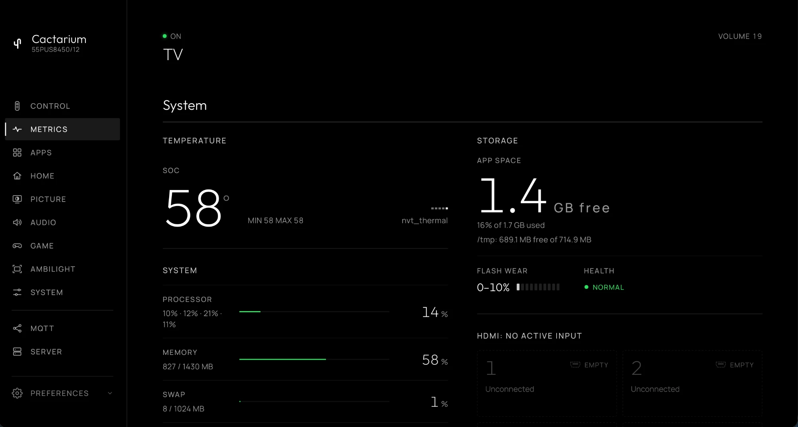

# Metrics

The **Metrics** tab, `/?tab=metrics`, shows what the TV is doing, from `/proc` and `/sys` on the TV. It follows Glasshouse's Metrics tab, and refreshes every 2 seconds while the tab is open. The temperature history is kept in the page, so it starts empty when the tab loads and holds the last 8 minutes.

* **Temperature.** The SoC temperature, large, with a bar trace of recent readings, the minimum and maximum of that history, and the sensor's name. It stays white up to 75 °C, turns amber from 75 °C and red from 85 °C. This TV has one sensor (`nvt_thermal`) and does not report a clock speed, so the MHz figure Glasshouse shows is left out.
* **System.** Rows with a level bar: **Processor** (total, with each core in the line below), **Memory**, **Swap** (the TV's zram), and **Network** (download rate for the link in use, then Wi-Fi signal in dBm, upload rate and the totals since boot). **Addresses** lists the host name and the TV's addresses.
* **Storage.** **App space**, the free space on the TV's writable partition with the share used, and the free space on `/tmp` below it. **Flash wear** shows the eMMC's own wear band in tenths of its life with its end-of-life warning as Normal, Warning or Urgent.
* **HDMI.** The four ports, from the TV's UI page: Active for the one on screen, Idle for a connected one, Empty for none, Unknown when the TV did not say. A port that carries a device name (HDMI-CEC) shows it. The section shows "Not available while an app is open" while a web app has the UI page frozen.
* **Advanced.** **System info** has uptime, load average, the number of processes, and Cactarium's own memory and goroutines. **Process memory** lists the largest processes by resident memory. **Detailed CPU usage** samples every process for a second and lists the busiest; it refreshes every 3 seconds, and only while it is open.

Skipped from Glasshouse because they depend on LG's services or hardware: the Magic Remote battery, the ambient light sensor, watch time, OLED and TCON firmware in System info, and per-port signal details (resolution, HDR, HDCP, VRR). A reading the TV does not provide is left out, never an error. The same sample feeds the Home Assistant sensors and `GET /api/stats`. The TV's own system information is under [System](advanced.md).
