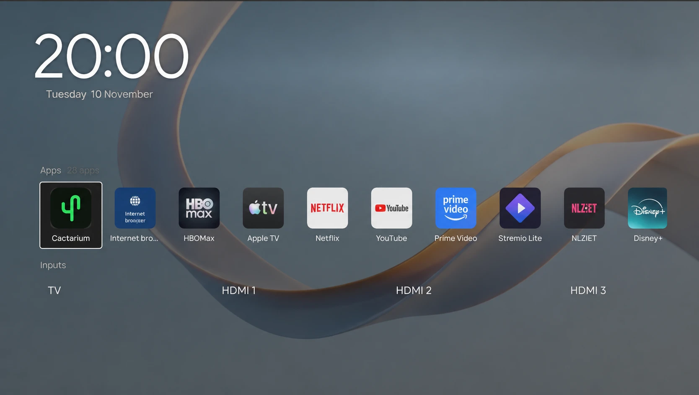
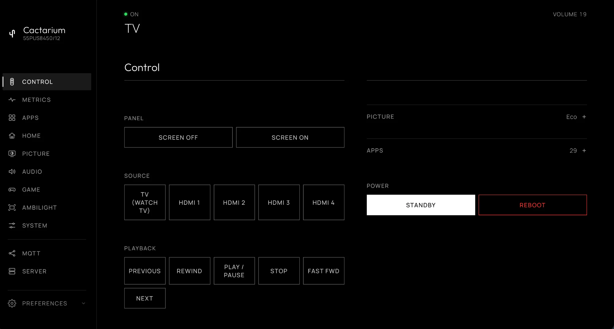

# Cactarium

**Your TV, your home screen.** A dashboard, a launcher and a Home Assistant bridge for Philips TitanOS TVs you can already reach over SSH.

> [!NOTE]
>
> ## You bought the TV.
>
> **It's your TV and you should control it.**
>
> Designed for those who would rather their network-connected home appliances
> were not a platform for advertising and vendor-controlled experiences, this
> project brings control, visibility and automation back to the device.
>
> Cactarium itself is local, transparent, and requires no cloud service of its
> own. No data collection, no ads, no dark patterns.

**Cactarium** is a small server that runs directly on a Philips TitanOS TV. It serves a live browser dashboard to any phone or computer on the home network, controls the TV through its local JointSpace API, reads hardware telemetry, bridges the TV to Home Assistant over MQTT, and can replace the TitanOS home screen with a launcher of its own.

It is one static Go binary with no runtime dependencies on the TV, modelled on [Glasshouse](https://github.com/rorygallagher2024/glasshouse), the equivalent project for LG webOS TVs. The launcher and dashboard themes are derived from it (see the `NOTICE` file in the repository).

### Compatibility at a glance

* **TV**: Philips 55PUS8450/12 (chassis TPN256E, Novatek NT72690), firmware TPN256E_V056.010.032.001. This is the only TV it has been tried on; other TitanOS TVs may work but nothing is confirmed
* **Access**: SSH to the TV (Dropbear on port 2222, key authentication) must already work. Cactarium does not root the TV or work around SELinux
* **Computer**: Go 1.22 or later, `make`, `ssh`, and `shasum` or `sha256sum`

---

## Quick start

1. Make sure `ssh -p 2222 root@<tv-ip>` works with a key.
2. Clone the repository on a computer on the same network as the TV.
3. Run `server/deploy.sh <tv-ip>` from the repository root.
4. Open `http://<tv-ip>:8090/` and pair with the TV in the Server tab.

The [installation guide](install.md) has the details and troubleshooting.

## What it's for

-   **[A phone and computer dashboard](dashboard/index.md)**

    ---

    Tabs for control, metrics, apps, home, picture, audio, game, Ambilight, system, MQTT and server, in any browser.

-   **[Controlling the TV without the cloud](dashboard/control.md)**

    ---

    Keys, volume, mute, power and Ambilight through the TV's local JointSpace API.

-   **[A launcher in place of the TitanOS home screen](launcher.md)**

    ---

    Home and power-on show a launcher with your apps from the TitanOS catalog, and the TV's inputs.

-   **[Keeping the TitanOS cloud launcher out of the way](launcher.md#blocking-the-titanos-cloud-launcher)**

    ---

    An optional, exact-name firewall block on `app.titanos.tv`.

-   **[Integrating the TV with a smart home](HOME-ASSISTANT.md)**

    ---

    One Home Assistant device through MQTT Discovery, with controls, sensors and buttons.

-   **[Seeing what the TV is doing](dashboard/metrics.md)**

    ---

    CPU, memory, temperatures, network, Wi-Fi signal and storage.

## Documentation

* [Installing](install.md), [updating and uninstalling](managing.md)
* [The dashboard](dashboard/index.md), tab by tab
* [The launcher](launcher.md)
* [Home Assistant](HOME-ASSISTANT.md)
* [Security](SECURITY.md) and [what it changes on the TV](TV-CHANGES.md)
* [Contributing](CONTRIBUTING.md) and [internals](IMPLEMENTATION.md)

## Disclaimer

**Use this software at your own risk.** It runs as `root` on an embedded TV OS and edits the TV's boot script and, optionally, a copy of its UI page. Each change has an [escape hatch](managing.md#if-something-goes-wrong), but the author accepts **no responsibility** for damage, bootloops, bricked devices, voided warranties or data loss. It is an independent, unofficial project, not affiliated with Philips, TP Vision or TitanOS. It bundles [Outfit](https://github.com/Outfitio/Outfit-Fonts) and [Manrope](https://github.com/sharanda/manrope) under the SIL Open Font License 1.1.

## License

Cactarium is released under the MIT licence (the `LICENSE` file). The parts derived from Glasshouse stay under Glasshouse's own MIT licence and keep its copyright notice; see the `NOTICE` file.
