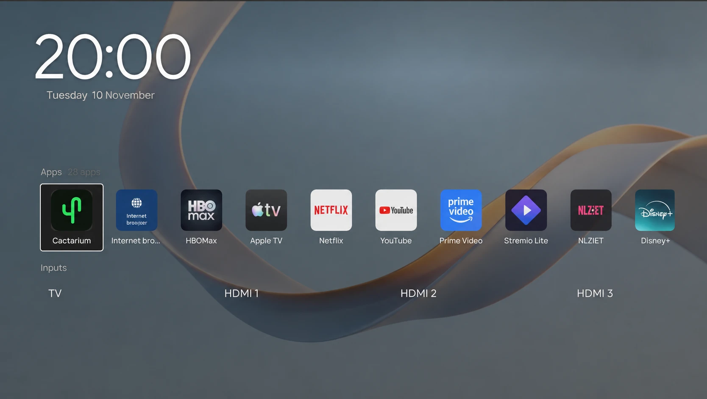

# The launcher

Cactarium can show its own launcher instead of the TitanOS home screen. It is optional and opt-in, and has been tried on one TV only (55PUS8450/12, firmware TPN256E_V056.010.032.001).



## What it shows

A full-screen page over the TV's picture, driven by the remote:

* **A background** behind everything: black, a picture for the part of the day, or an animated one (see [Background](#background)).
* **A header** with a clock, the date and, if you set a location, a weather badge.
* **Apps**: **Cactarium** first (the [TV app](#the-cactarium-tile), below), then the apps from the TitanOS catalog or the TV's own list, then a **TitanOS home** tile (the stock home screen). The TV's settings stay on the remote's own Settings key; restarting the TV is in the dashboard.
* **Inputs**: **TV**, **HDMI 1** to **HDMI 4**, and a **Sources** tile that opens the TV's own source list.

The D-pad moves, OK opens, and Back closes the launcher. It remembers where the focus was.

## The Cactarium tile

The first tile of the Apps row opens the TV app (`/tvapp`), a remote-driven version of the dashboard ported from Glasshouse's TV app, served to the TV itself only; see [the TV app](dashboard/tv-app.md).

The launcher navigates its own frame to `/tvapp` (it does not use `loadApp`, which freezes PHI). The page keeps the launcher's heartbeat and passes keys it does not use (Home, volume) to the hook. **Back** returns to `/launcher`, with the Cactarium tile still focused; **Home** does too, as it resets the launcher.

The page reads `GET /api/tvapp`, which only the TV itself (loopback) may call, so it needs no access token and the token is never exposed. The QR code holds the dashboard's address (`http://<tv-ip>:8090/`, the TV's LAN address as the server finds it) and no token; with a token set, the dashboard asks for it. Fonts and the QR encoder are served by the server; nothing is fetched from the internet.

## The app row mirrors your TitanOS apps

The TV has a public app catalog that TitanOS itself uses (`eu.app.titanos.tv`). Set `launcher.apps` in `config.json` to the catalog **codes** of the apps in your TitanOS row, in order, and the launcher shows them with TitanOS's own names, icons and launch addresses. The code `"tv"` (TitanOS lists the TV input as an app) is skipped: the TV input is the first tile of the Inputs row.

```json
{
  "launcher": {
    "apps": ["tv", "netflix", "youtube"],
    "catalog": { "market": "NL", "locale": "nl", "model": "<model>", "firmware": "<firmware>" }
  }
}
```

(The codes above are examples: look yours up in the catalog cache at `var/titan-catalog.json` on the TV, which is a list of apps with their `code`s.)

* The catalog is only fetched once **both** `model` and `firmware` are set, because the API refuses a request without a firmware. `market` and `locale` default to `NL` and `nl`.
* It is downloaded at start if the cache is missing or older than 24 hours, then every 24 hours; after a failure it retries in 10 minutes. Changing the catalog settings refreshes it at once.
* Icons are downloaded once per app, resized, and cached in `var/titan-icons/`.
* Codes the catalog does not have are reported by `GET /api/launcher/apps` as `missing` and skipped. A tile that needs something the launcher cannot start shows "not supported here".
* Web apps open through the TV browser's `loadApp(address, name, type, resolution)`, with the type and window resolution (720p or 1080p) from the catalog, as TitanOS's own launcher does. PHI's `RpcAppsWakeup` with the same address is accepted but brings up the TitanOS cloud launcher instead, or a blank screen while it is blocked (verified with Red Bull TV on 55PUS8450/12, TPN256E_V056.010.032.001). Media, Simple Setup and Alexa open the TV's own pages, as the stock launcher does.
* With `launcher.apps` empty, the row is the TV's own app list, labelled "built-in list".

The [Home tab](dashboard/home.md) edits the app row.

## What Home, Back and power-on do

Once installed, a small script in the TV's UI page (the **hook**, `phi-hook.js`) listens for the Home key before the TV does.

* **Home** shows the launcher, over a running app too. A held key's repeats are ignored.
* **Home twice quickly** (within about 800 ms) opens the stock TitanOS home. So does the **TitanOS home** tile.
* **Home from a channel or an HDMI input** leaves it for the Smart TV source the way TitanOS's own Home does, so the stream stops and uses no bandwidth while the launcher is up. **Back** then starts it again: a channel (the streaming ones included) through the TV's Watch TV and a retune of the channel you were on, an HDMI input by switching back to it. If leaving fails, the launcher shows over the source with the TV's system mute on instead.
* **Back** in the launcher closes it and returns to what was behind it.
* **Back out of a web app** brings the launcher back. A web app runs in the browser's main window and PHI's page is frozen meanwhile; the hook takes its own wake-up after a launch as the app's exit. Without this the TV falls back to a TV channel or a black screen.
* **Sources** opens the TV's own source list over the launcher. The launcher returns when you close them.
* **Power-on.** After a wake from standby, or a cold boot, the hook shows the launcher where TitanOS would show its own home: when the TV is on the Smart TV source with no TV page open. If the TV resumes on HDMI or a channel, the launcher stays out of the way. TitanOS's own start-up steps after a wake would hide it, so the hook puts it back for about 15 seconds.
* **The kill switch.** The hook starts disabled and only turns on after a successful reply from `GET /api/launcher/enabled`. It checks again every 20 seconds and on every Home press. If Cactarium is down or unreachable, Home is stock. If the launcher page does not report ready within about 3.5 seconds, or stops sending its heartbeat for 9 seconds, the hook removes it and runs the stock home.

Choose **TitanOS Home** on the dashboard's Home tab to switch it off without a reboot.

## Installing

First deploy a build that serves `phi-hook.js` (`server/deploy.sh <tv-ip>`), then:

```bash
server/deploy.sh <tv-ip> --install-home      # copy, relabel and add the hook line (idempotent)
server/deploy.sh <tv-ip> --home-status       # copy, labels, mount, hook line, md5s
```

Then **cold boot** the TV: unplug it from AC power for 10 seconds. The page tree is mounted at boot, and a changed `index.html` is only read at boot. The script says when this applies. What the install does is listed in [what it changes on the TV](TV-CHANGES.md#the-home-button-launcher). The copy is relabelled because the TV's browser cannot read the unlabeled files `/swdl` has by default.

To undo it:

```bash
server/deploy.sh <tv-ip> --remove-home-line  # put the stock index.html back, keep the copy
server/deploy.sh <tv-ip> --remove-home       # delete /swdl/UI; the stock tree returns after a cold boot
```

If something goes wrong, see [Updating and uninstalling](managing.md#if-something-goes-wrong).

## Blocking the TitanOS cloud launcher

At boot the TV's browser preloads the cloud launcher (`https://app.titanos.tv`) and only brings it to the front on Home or power-on; no setting stops that. With `launcher.block_titanos` on, Cactarium adds firewall rules that reject DNS queries and TLS connections for exactly that name, so the TV falls back to its local offline launcher. It does not touch sign-in or the API (`api.titanos.tv`), and it does not block `eu.app.titanos.tv`, which the app row uses. The rules are applied at every start and removed when the setting is off. The setting is in `config.json` and `POST /api/settings`; the dashboard does not show it yet. Details are in [what it changes on the TV](TV-CHANGES.md#network).

## Background

`launcher.background` (the Home tab's [Background](dashboard/home.md#background)) sets what is drawn behind the clock and rows, as Glasshouse Home does. The launcher reads it from `GET /api/launcher/background` (no token, like its other endpoints) every time it is shown, and loads the pictures from `GET /launcher/wallpaper?slot=morning|afternoon|evening|night`.

* **None** is black. **Pictures** shows the picture for the part of the day (night 21:00 to 06:00, morning from 06:00, afternoon from 11:00, evening from 17:00) at 55 to 72% over black, cross-fading over 2.4 s when the part changes and drifting 4% over 3 minutes so that it does not sit still on the panel. A time of day without a picture is black.
* **Animated** draws one of seven canvas scenes (`background.js`, ported from Glasshouse Home) on a 960 × 540 canvas scaled up. It runs at 20 frames a second, or 10 when a frame takes longer than 28 ms to draw on average, and only while the launcher is on screen: the hook sends `{type:'hidden'}` when it puts the page away, `{type:'shown'}` when it brings it back, and `hello.visible` says which at load, so the page, which is kept loaded while hidden, does no drawing. With `prefers-reduced-motion` set it draws one still frame.
* **Darkening** is the opacity of the scrim over the background, `darkening / 100` of its own (and 42% of that over an animated one). The text colour is not a background setting; the launcher's text stays warm white.

Not measured: how much of the TV's CPU an animation takes (Glasshouse's rates for older TVs were chosen on an LG B8, not on this TV).

## Weather

Set the weather latitude and longitude on the Home tab. The launcher then shows the temperature and conditions from Open-Meteo (no API key). The server asks at most once every 30 minutes (two minutes after a failure). Leave both empty to turn it off.

## Layers

`launcher.layer` is how the hook puts the launcher in front of an app. `"page"` (the default) opens the TV UI's blank page so its window stack has a window for the launcher, which lets Settings and Sources return to it. `"state"` only sets the UI state.

## Troubleshooting

* **Home shows the stock home.** Check the hook is installed (`--home-status`: "index.html hook line: present", "PHI/page mount: yes"), that Cactarium is running, and that `launcher.enabled` is on. `GET /api/home/diag` on the dashboard's port lists what the hook saw.
* **The TV's menus are empty.** The page copy may be unreadable to the browser. Run `--home-status` and check every label is `default_t`, or `--remove-home` and cold boot.
* **The app row is the built-in list.** `launcher.apps` is empty, or the catalog has not been fetched (model and firmware unset).
* **An app does not start.** Press Home twice for the stock home, and look for `action-failed` in `GET /api/home/diag`.

## The dashboard bridge

PHI's `Rpc*` functions are the only way to the TV's picture, sound and general settings: the native JSON-RPC socket refuses Cactarium. The hook (`phi-hook/0.38`) therefore long-polls the server for jobs and runs them inside PHI's page. The dashboard uses it through three token-protected routes:

* `POST /api/tv/phi` with `{"method":"RpcX","params":{...}}` answers `{"result":...}`, or 400 (method not on the allowlist, `server/lib/routes/phi_allow.go`), 502 (the call rejected) or 504 (no answer in 5 seconds: the hook is not loaded, or a web app is running, which freezes PHI's page). The pseudo-method `launch` starts an app: `params` is one entry of `GET /api/launcher/apps`.
* `POST /api/tv/reboot` asks PHI for `RpcRestartTV`; if the hook is silent for 3 seconds the server runs `sync; reboot -f` itself, and does the same if the TV is still up 20 seconds after PHI accepted the restart.
* `GET /api/launcher/wallpapers` (picture status), `POST /api/launcher/wallpapers/upload?slot=<morning|afternoon|evening|night>` (a JPEG body up to 5 MB and 1920 × 1080), `POST /api/launcher/wallpapers/remove` (`{"slot":"morning"}` or `{"all":true}`) and `POST /api/launcher/wallpapers/set` (`{"set":"landscape"|"abstract"}`, downloads the set and chooses it) back the Home tab's Background section. They need the token when one is set.
* `GET /api/titan/catalog` lists the cached TitanOS catalog (`code`, `name`, `icon`, `app_type`) so the dashboard can offer apps for `launcher.apps`.

How the hook and the server talk:

* The hook long-polls `GET /api/tv/phi/next` (XHR from the file:// page; the server holds it up to 25 s). 204 means no job; 200 is `{"id":n,"method":"RpcX","params":{...}}`. It polls again at once after a job or a 204, and after 3 s on an error.
* It runs `window[method]({params})` and posts `text/plain` `{"id":n,"ok":true,"result":...}` or `{"id":n,"ok":false,"error":"..."}` to `POST /api/tv/phi/result`. `RpcRestartTV` with no params is called bare, as PHI's own dialog does.
* The server queues jobs by id, so concurrent dashboard requests each get their own result. A request not answered in 5 s gets 504 and its job is dropped.
* The hook accepts only `/^Rpc[A-Za-z0-9]+$/`, `launch`, `sources` or `source`, and only if `typeof window[method] === 'function'`. The server's allowlist is the real gate.
* `sources` answers what the launcher's Inputs row shows (`{sources:[{typeId,name,sub,kind,connected,current}],current}`) and `source` switches to `{typeId}`.
* `launch` takes one entry of `GET /api/launcher/apps` and maps it as the launcher does (native apps, web apps through `loadApp`, `media`/`simple_setup`/`alexa`, `tv` as the TV input). Because `loadApp` freezes the page, the hook answers `{}` after 1.5 s if the launch has not settled.
* While a web app runs PHI's JS is frozen, so the poll is not answered and requests time out with 504.
